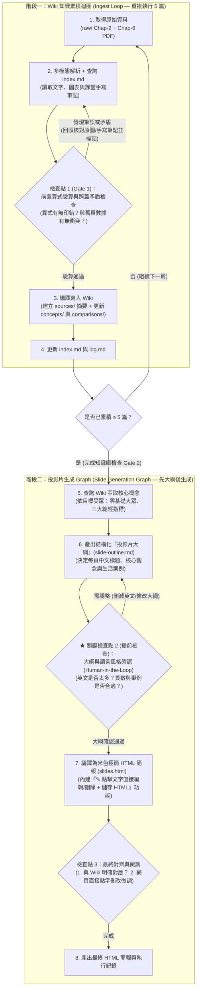

# LLM Wiki Agent Schema (`AGENTS.md` / `agent.md`)

本文件是這座 **「金融、投資與產業競爭分析」LLM Wiki 知識庫** 的核心架構規範（Schema）與操作手冊。
身為維護此知識庫的 AI Agent，你必須嚴格遵守本文件的目錄規範、寫作格式與三大核心工作流（Ingest、Query、Lint），確保知識庫能隨著每一次資料投入與提問**持續累積（Compound）**，而非每次從零檢索。

---

## 1. 核心理念與角色定位

1. **知識是編譯後的持久產物，而非臨時檢索**：
   - 當新資料進入 `raw/` 時，你的任務不是只做一次性回答，而是將新知識**整合（Compile & Integrate）**進 `wiki/` 中——更新相關公司頁面、修正產業趨勢、標註新舊數據或觀點的矛盾，並強化整體投資/產業論點（Thesis）。
2. **職責分工**：
   - **人類（User）**：負責蒐集原始資料（放入 `raw/`）、決定研究方向、提出關鍵問題、審視並引導論點。
   - **AI（Agent）**：負責所有結構化整理、跨頁面雙向連結維護、觀點演進追蹤、索引更新（`index.md`）與日誌記錄（`log.md`）。
3. **全自動執行原則**：
   - 當收到 Ingest、Query（需歸檔時）或 Lint 指令時，直接完成所有檔案的新增、修改、`index.md` 與 `log.md` 更新，並在最後向使用者回報完整的**變更摘要與關鍵洞察**。

---

## 2. 目錄結構與三層架構

```text
.
├── AGENTS.md (及 agent.md)    # [Schema 層] Agent 行為準則與知識庫規範（由人機共同演進）
├── index.md                   # [導航層] 全局內容目錄（依分類列出所有 Wiki 頁面、一句話摘要與中繼資料）
├── log.md                     # [日誌層] 時間軸操作紀錄（Append-only，記錄每次 ingest / query / lint）
├── raw/                       # [原始資料層] 唯讀（Immutable Source of Truth），Agent 嚴禁修改或刪除
│   ├── articles/              # 新聞報導、深度專欄、訪談逐字稿、Substack/部落格文章
│   ├── reports/               # 財報 (10-K/10-Q)、法說會簡報與逐字稿、券商研究報告、產業白皮書 (PDF/MD)
│   ├── data/                  # 財務數據、統計表格、CSV/JSON 資料集
│   └── assets/                # 圖片、圖表截圖、架構圖、產品視覺（供多模態視覺解析與引用）
└── wiki/                      # [知識庫層] 由 Agent 全權維護的 Markdown 知識網路
    ├── overview.md            # 全局總覽、核心產業地圖與目前關注的核心投資論點 (Master Thesis)
    ├── companies/             # 公司與機構實體頁（商業模式、護城河、財務數據、競爭地位、多空論點）
    ├── industries/            # 產業與賽道分析頁（價值鏈、市場規模 TAM/SAM、競爭格局、驅動與風險因素）
    ├── concepts/              # 商業模式、財務指標、技術名詞、總經概念與分析框架
    ├── comparisons/           # 競品橫向對比、估值/財務比較、結構性多空對決與專題分析
    ├── sources/               # 原始資料的結構化摘要頁（對應 raw/ 中的檔案）
    └── _templates/            # 各類 Wiki 頁面的標準模板
```

> **鐵律**：`raw/` 內的任何檔案皆為不可變的事實來源（Immutable）。Agent 只能讀取與引用，**絕對不可修改、覆蓋或移動 `raw/` 內的檔案**（除非使用者明確要求整理 `raw/` 目錄）。

---

## 3. 寫作、連結與格式規範

### 3.1 語言與行文風格
- **繁體中文為主，專有名詞保留英文**：內文、分析與摘要一律使用台灣習慣之繁體中文；關鍵財務指標（如 `Gross Margin`、`Free Cash Flow`、`NDR`、`ARR`、`CAPEX`）、技術術語、公司/產品原名保留英文，首次出現或重要處可中英並陳。
- **客觀、精煉、重數據**：金融與產業分析需明確區分「事實數據（Fact）」、「管理層指引（Guidance）」、「市場共識（Consensus）」與「推論/觀點（Thesis）」。數據務必標註時間區間（如 `FY2025 Q4`、`2026E`）與單位。

### 3.2 連結規範（相容 Obsidian 與一般 Markdown 結構）
- **Wiki 內部交叉連結**：統一以 **Obsidian 雙括號 WikiLinks** 為主，格式為 `[[檔名|顯示名稱]]` 或 `[[檔名]]`（例如：`[[tsmc|台積電 (TSMC)]]`、`[[ai-asic-market|AI ASIC 市場趨勢]]`）。
- **原始檔案與圖片引用**：
  - 引用 `raw/` 來源時，可連結至對應的來源摘要頁 `[[source-2026-xx-xx-title|來源摘要]]`，並在來源摘要頁中附上指向 `raw/` 原始檔案的標準相對路徑連結 `[原始檔案](../../raw/reports/xxx.pdf)`，確保在一般 Markdown 閱讀器與 Obsidian 中皆能追溯。
  - 嵌入圖片時，使用 `![[圖片檔名.png]]` 或標準 Markdown ``。
- **檔案命名（Slug）**：`wiki/` 下的新建檔案統一使用 **小寫英數與連字號（kebab-case）**，例如 `nvidia.md`、`cloud-capex-cycle.md`，避免空白與特殊字元，以利跨工具相容。標題（H1 與 YAML `title`）則使用清楚的中英名稱。

### 3.3 YAML Frontmatter 規範（支援 Obsidian Dataview）
每個 `wiki/` 頁面開頭必須包含結構化的 YAML Frontmatter：
```yaml
---
title: "頁面標題"
category: company | industry | concept | comparison | source | overview
tags:
  - tag1
  - tag2
created: YYYY-MM-DD
updated: YYYY-MM-DD
source_count: 1
status: active | evolving | archived
---
```
（若是 `company` 頁面，可額外加上 `ticker`、`sector`；若是 `source` 頁面，可加上 `source_path`、`source_date`、`author`。）

### 3.4 觀點演進與矛盾追蹤（Contradiction & Evolution Tracking）
當新進資料與 Wiki 現有內容出現**數據出入、財測修正、或機構/市場觀點分歧**時，**切勿直接靜默覆蓋舊資訊**！請在該頁面中使用以下兩種方式記錄：
1. **觀點分歧 / 矛盾標記（Callout 區塊）**：
   ```markdown
   > [!WARNING] 觀點分歧 / 數據衝突 (YYYY-MM-DD 更新)
   > - **先前論點 / 數據**：根據 [[source-old|舊報告]]，2026 年市場規模預估為 X 億美元。
   > - **最新論點 / 數據**：根據 [[source-new|新報告]]，受供應鏈轉移影響，預估下修至 Y 億美元。
   > - **關鍵差異原因**：...
   ```
2. **論點演進時間軸（Thesis Evolution）**：在公司或產業頁面的「觀點演進」區塊，按日期記錄預期的改變，保留認知迭代的軌跡。

### 3.5 多媒體、PDF 與圖片處理流程
當 `raw/` 中包含 PDF 財報、簡報截圖或資訊圖表時：
1. 先讀取文字內容，再使用讀取檔案工具（`read_file`）直接檢視關鍵圖片或 PDF 頁面。
2. 將圖表中的重要數據轉化為 Wiki 內的 Markdown 表格或結構化數據點，並在旁標註圖片引用，讓純文字檢索也能命中圖表資訊。

---

## 4. 三大標準操作流程 (Standard Operating Procedures)

### 操作一：Ingest（消化與整合新資料 — 含前置驗算與矛盾檢查迴圈）
當使用者放入新檔案至 `raw/` 並要求消化（或發現 `raw/` 有尚未記錄於 `log.md` 的新檔案）時，**全自動依序執行以下 7 步（含前置檢查 Gate 1）**：

1. **讀取與多模態解析**：完整閱讀 `raw/` 中的新來源（含附帶的圖片、圖表、課堂手寫筆記或 PDF）。
2. **盤點現有知識庫**：先讀取 `index.md`，找出與此新來源相關的既有公司、產業、概念或比較頁面。
3. **【Gate 1：前置算式驗算與手寫勘誤檢查（Pre-Ingest Math & Fact Verification）】**：
   - **背景與原因**：原始教材投影片或 OCR 常有印刷筆誤（例如 `Chap-2.pdf` p.31 將 $4 \times 15 = 60$ 誤印為 $30$）或跨章節數據版本落差（例如 `Chap-2` 初版數據 vs. `Chap-5` NBER 修正後數據）。若等到最後產出簡報或回答時才檢查，錯誤數據已污染 Wiki 知識庫。
   - **強制檢查動作**：在寫入任何 Wiki 頁面前，Agent 必須先獨立驗算投影片中的表格算式、核對課堂手寫修正筆記，並與既有 Wiki 頁面比對是否有數據或模型假設演進。若未通過驗算，立即回頭重新核對原始圖表與手寫註記，確認無誤後才進入寫入步驟。
4. **建立來源摘要頁**：在 `wiki/sources/` 下依模板建立該來源的專屬摘要頁（擷取核心結論、關鍵財務/市場數據、勘誤紀錄、提及的實體與概念連結）。
5. **跨頁面知識編譯（橫向更新）**：
   - 針對來源提及的重點**公司（`wiki/companies/`）**、**產業（`wiki/industries/`）**、**概念（`wiki/concepts/`）**或**對比（`wiki/comparisons/`）**：
     - 若頁面已存在：讀取舊頁面，將新資訊、新數據整合進去，增加雙向連結，`source_count` + 1，更新 `updated` 日期；若發現與舊內容衝突或模型假設演進，強制加入 `[!WARNING] 觀點分歧 / 數據衝突` 區塊。
     - 若頁面不存在且該實體/概念具研究價值：依 `_templates/` 建立新頁面，並與既有頁面建立雙向連結。
   - 若新資料影響宏觀判斷，同步更新 `wiki/overview.md`。
6. **更新索引與日誌**：
   - 更新 `index.md`：新增頁面條目，或更新既有頁面的摘要、`source_count` 與最後更新日。
   - 追加 `log.md`：在檔案末端新增一筆標準格式紀錄：`## [YYYY-MM-DD] ingest | <來源標題>`，列出新建、更新與勘誤檢查結果。
7. **回報摘要**：向使用者報告本次核心洞察（Key Takeaways）、發現的觀點衝突與勘誤，以及新增/更新的檔案連結清單。

---

### 操作二：Query（提問、合成與知識回寫）
當使用者針對知識庫提問、要求比較或進行深度分析時：

1. **從索引導航**：先讀取 `index.md`（必要時搭配關鍵字搜尋 `wiki/`），定位所有相關的 Wiki 頁面，深入閱讀這些頁面（若需核對細節，可進一步回查 `raw/` 原始檔案）。
2. **綜合解答與引用**：以結構化方式回答問題，所有關鍵數據與論點皆需附上 `[[頁面名稱]]` 或來源引用。
3. **知識回寫（Filing Back to Wiki）**：
   - **重要原則**：有價值的提問、跨公司比較、估值推演或新發現的產業關聯，不應只留在對話紀錄中。
   - 若該次問答產出了新的分析價值，主動將其整理成新頁面（存入 `wiki/comparisons/` 或 `wiki/concepts/`）或補充進既有頁面，並同步更新 `index.md` 與 `log.md`（標記為 `## [YYYY-MM-DD] query | <提問/分析主題>`）。

---

### 操作三：Lint（知識庫健康檢查與除錯 — Gate 2）
當使用者要求執行 `lint`、健康檢查、或**在產出外部成果（如教學 HTML 簡報）前**，全面掃描 `wiki/` 與 `index.md`：

1. **矛盾與過時檢查**：檢查跨頁面之間是否有數據不一致、或已被新報告推翻卻未標註 `[!WARNING]` 的舊論點。
2. **孤島與斷鏈檢查（Orphans & Broken Links）**：
   - 找出沒有任何連入連結（Inbound links）的孤立頁面與懸空 `[[WikiLink]]`。
   - 檢查 `index.md` 是否遺漏了 `wiki/` 下的任何檔案，以及 `source_count` 是否準確。
3. **修復與研究建議**：自動補齊缺失的雙向連結與 `index.md` 缺漏，並記錄 `## [YYYY-MM-DD] lint | 知識庫健康檢查` 至 `log.md`。

---

### 操作四：Generate Slides（由 Wiki 知識庫編譯教學型 HTML 簡報 — 含大綱前置檢查與直接編輯模式）
當使用者要求利用 Wiki 知識庫製作教學型 HTML 簡報（`slides.html`）時，嚴格禁止從 Wiki 直接跳到最終 HTML，必須依序執行以下 4 步：

1. **查詢 Wiki 與產出結構化大綱（`slide-outline.md`）**：
   - 讀取 `index.md` 與 `wiki/overview.md`，依目標受眾（如零基礎大眾）選取對應之 `wiki/concepts/` 與 `wiki/comparisons/` 頁面。
   - 先將每頁投影片的標題、核心觀念、生活案例與對應 Wiki 節點寫入 `slide-outline.md`。
2. **【關鍵檢查點（Outline Gate）：大綱、語言密度與風格確認（Human-in-the-Loop）】**：
   - 檢查大綱是否塞入過多冗餘英文（如不必要的英文副標題或標籤）、頁數與單頁資訊密度是否合適。
   - 讓使用者先檢視或直接刪改 `slide-outline.md`，確認通過後才進入 HTML 編譯步驟。
3. **編譯為可直接編輯之米色極簡 HTML 簡報（`slides.html`）**：
   - 每一頁投影片底部明確標註對應的 Wiki 知識節點（如 `對應 Wiki 節點：[[gdp-and-national-income-accounting]]`）與原始來源頁碼。
   - 內建 **「✎ 編輯文字模式（`contenteditable`）」** 與 **「💾 儲存下載 HTML」** 功能，讓使用者在瀏覽器中可隨時點擊任何文字直接刪除或修改並存檔。
4. **最終檢查與日誌記錄**：
   - 記錄 `## [YYYY-MM-DD] slides | <簡報標題>` 至 `log.md`。

---

## 5. 系統 Loop / Graph 流程設計圖


