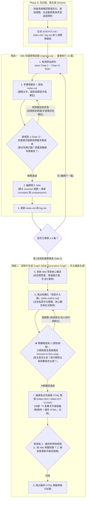

# 總體經濟學 LLM Wiki 知識庫與教學型 HTML 簡報 (`hw10`)

> **TAICA 生成式AI：文字與圖像生成的原理與實務｜第十週作業（1110）：用 LLM Wiki 做一份教學 HTML 簡報**

本儲存庫實作 Andrej Karpathy 的 **LLM Wiki** 知識庫模式，完整消化 **Olivier Blanchard《Macroeconomics (8th Edition)》第 2 章至第 11 章（共 10 份核心講義、499 頁投影片）**，編譯為 **30 個雙向連結的 Markdown 知識節點（`wiki/`）**，並以此知識庫為唯一事實來源，產出兩份溫暖米色極簡、內建互動模擬器與 **「✎ 網頁直接點擊編輯文字 + 💾 儲存下載 HTML」** 的教學型 HTML 簡報。

---

## 🎯 快速瀏覽成果連結

1. **完整作業報告（含 Loop / Graph 流程圖、執行檢查紀錄與反思）**：
   - 📄 **[homework-submission.md](homework-submission.md)**（或直接向下滾動閱讀本頁）
2. **教學型 HTML 簡報（共 2 部，下載後直接以瀏覽器開啟即可互動與點擊編輯文字）**：
   - 📊 **[slides.html](slides.html)** —— **《如何看懂財經新聞的三大指標？》（第 2～6 章：GDP、失業率、通膨與短期景氣篇，共 16 頁）**
     - 大綱檢查檔：[slide-outline.md](slide-outline.md)
   - 📊 **[slides-ch7-11.html](slides-ch7-11.html)** —— **《薪水、通膨與國家富裕的終極密碼》（第 7～11 章：短期 vs. 中期大對決、菲利浦曲線與長期索洛成長模型篇，共 18 頁）**
     - 大綱檢查檔：[slide-outline-ch7-11.md](slide-outline-ch7-11.md)
3. **LLM Wiki 核心三層架構入口**：
   - 🧭 **[AGENTS.md](AGENTS.md)**：Agent 行為規範、寫作準則與雙迴圈 Workflow Graph 定義
   - 🗂️ **[index.md](index.md)**：全局知識庫目錄索引（30 個 Wiki 頁面總覽）
   - 🕒 **[log.md](log.md)**：時間軸操作與三道檢查關卡（Gate 1～Gate 3）攔截日誌
   - 🌐 **[wiki/overview.md](wiki/overview.md)**：總體經濟短、中、長期全局綜合視圖與 6 項教材勘誤紀錄

---

## 🔄 系統 Loop / Graph 流程設計圖

---

## 📚 知識庫完整檔案結構（30 個 Wiki 節點）

- **全局總覽**：[wiki/overview.md](wiki/overview.md)
- **核心概念頁（`wiki/concepts/`，共 14 頁）**：
  1. [gdp-and-national-income-accounting.md](wiki/concepts/gdp-and-national-income-accounting.md) — GDP 三面等價、主計總處 GNI/NNI/NI/PI、台美支出比重、2001 衰退數據修正衝突
  2. [unemployment-and-labor-market-indicators.md](wiki/concepts/unemployment-and-labor-market-indicators.md) — 失業率、勞參率代數推導、怯志工作者、廣義失業率、自然失業率
  3. [inflation-and-price-indexes.md](wiki/concepts/inflation-and-price-indexes.md) — 通膨/通縮/通膨減緩、拉氏高估 vs. 畢氏低估偏誤
  4. [okuns-law-and-phillips-curve.md](wiki/concepts/okuns-law-and-phillips-curve.md) — 歐肯法則（台美係數差異與勞動囤積 Labor Hoarding）與菲利浦曲線
  5. [macroeconomic-time-horizons.md](wiki/concepts/macroeconomic-time-horizons.md) — 極短期、短期、中期、長期分析架構
  6. [goods-market-and-multiplier.md](wiki/concepts/goods-market-and-multiplier.md) — 凱因斯消費函數、三種乘數公式、節儉矛盾
  7. [money-market-and-monetary-policy.md](wiki/concepts/money-market-and-monetary-policy.md) — 台灣 M1A/M1B/M2、公開市場操作債券定價、貨幣乘數、流動性陷阱
  8. [is-lm-model-and-policy-mix.md](wiki/concepts/is-lm-model-and-policy-mix.md) — 內生投資 IS 曲線、水平/正斜率 LM、排擠效果與短期 6 季物價僵固實證
  9. [extended-is-lm-and-financial-crisis.md](wiki/concepts/extended-is-lm-and-financial-crisis.md) — 費雪方程式、風險溢酬、銀行槓桿與 2008 次貸金融海嘯
  10. [labor-market-wage-and-price-setting.md](wiki/concepts/labor-market-wage-and-price-setting.md) — 勞動市場流動、效率工資（1914 亨利·福特日薪 5 美元）、WS-PS 模型
  11. [expectations-augmented-phillips-curve.md](wiki/concepts/expectations-augmented-phillips-curve.md) — 附加預期菲利浦曲線、三次變異、工資指數化、名目工資向下僵固性、沃克反通膨
  12. [is-lm-pc-medium-run-and-supply-shocks.md](wiki/concepts/is-lm-pc-medium-run-and-supply-shocks.md) — IS-LM-PC 中期收斂、貨幣中立性、1929 大蕭條通縮螺旋、石油危機停滯性通膨
  13. [economic-growth-ppp-and-happiness.md](wiki/concepts/economic-growth-ppp-and-happiness.md) — 美俄購買力平價（PPP）算例、伊斯特林悖論 vs. 131 國快樂實證、馬爾薩斯陷阱與四小龍收斂
  14. [solow-growth-model-and-golden-rule.md](wiki/concepts/solow-growth-model-and-golden-rule.md) — 索洛成長模型、穩態、二戰後法國重建奇蹟、黃金法則儲蓄率與「明天存更多」
- **跨維度專題對比頁（`wiki/comparisons/`，共 5 頁）**：
  1. [fixed-base-vs-chain-linked-gdp.md](wiki/comparisons/fixed-base-vs-chain-linked-gdp.md) — 定基法 vs. 連鎖法實質 GDP
  2. [cpi-vs-pce-vs-gdp-deflator.md](wiki/comparisons/cpi-vs-pce-vs-gdp-deflator.md) — CPI vs. PCE vs. GDP 平減指數
  3. [fiscal-vs-monetary-policy-in-is-lm.md](wiki/comparisons/fiscal-vs-monetary-policy-in-is-lm.md) — 財政 vs. 貨幣政策與三大歷史政策組合（1990s / 2001 / 2008）
  4. [short-run-vs-medium-run-macro.md](wiki/comparisons/short-run-vs-medium-run-macro.md) — 短期 vs. 中期大對決：需求驅動 vs. 供給約束與政策相反結局
  5. [saving-short-run-paradox-vs-long-run-growth.md](wiki/comparisons/saving-short-run-paradox-vs-long-run-growth.md) — 儲蓄的跨期大對決：短期節儉矛盾 vs. 中期降息轉投資 vs. 長期索洛資本累積
- **原始教材結構化摘要頁（`wiki/sources/`，共 10 頁）**：
  - [source-blanchard-chap-2.md](wiki/sources/source-blanchard-chap-2.md) ～ [source-blanchard-chap-11.md](wiki/sources/source-blanchard-chap-11.md)

---

*(詳細步驟說明與反思請見 [homework-submission.md](homework-submission.md))*
