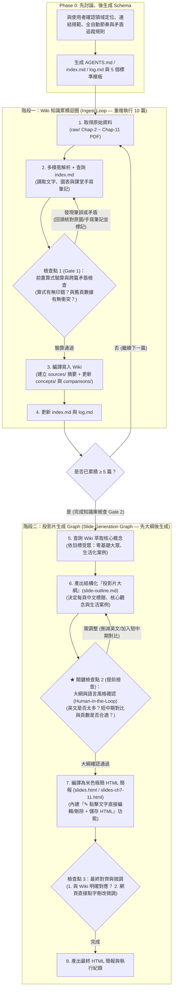

# 第十週作業：用 LLM Wiki 做一份教學 HTML 簡報

> **繳交標題格式範例**：`學校 學號 系級 姓名 總體經濟學 LLM Wiki 與教學簡報`
> **GitHub 專案儲存庫**：[https://github.com/sd94031187/hw10](https://github.com/sd94031187/hw10)

---

## 1. LLM Wiki 主題與簡短介紹

- **主題名稱**：**總體經濟學：從短期景氣、中期通膨到長期國家富裕之謎（Blanchard Macroeconomics LLM Wiki 知識庫）**
- **簡短介紹**：
  本專案參考 Andrej Karpathy 的 **LLM Wiki** 架構，採用 **「先與 AI 討論釐清規範（`AGENTS.md`）➔ 消化資料累積 Wiki（含 Gate 1 前置算式與手寫勘誤檢查）➔ 先產出大綱確認（`slide-outline.md`，Gate 2）➔ 再編譯為可直接編輯之教學 HTML 簡報（`slides.html` & `slides-ch7-11.html`）」** 的雙迴圈工作流。
  不同於傳統 RAG 每次從零檢索零碎片段，本知識庫在消化 **10 份核心課程講義（`Chap-2.pdf` 至 `Chap-11.pdf`，合計 499 頁投影片，含台灣行政院主計總處、中央銀行定義補充與課堂手寫筆記）** 的過程中，將知識結構化編譯為 **30 個雙向連結（`[[WikiLinks]]`）的 Wiki 頁面**（包含 1 個全局總覽 `overview.md`、14 個核心概念頁 `concepts/`、5 個跨維度專題對比頁 `comparisons/` 與 10 個來源摘要頁 `sources/`），並由 `index.md` 與 `log.md` 維護全局導航與時間軸紀錄。
  最後針對「**完全沒學過經濟學的大學生與一般大眾**」，以此 Wiki 為唯一知識來源，編譯出兩份溫暖米色極簡、內建生活互動試算與 **「✎ 網頁直接點擊編輯／刪除文字 + 💾 儲存下載 HTML」** 功能的教學型 HTML 簡報：
  1. **[slides.html](slides.html)（第 2～6 章：如何看懂財經新聞的三大指標與短期景氣，共 16 頁）**
  2. **[slides-ch7-11.html](slides-ch7-11.html)（第 7～11 章：短期 vs. 中期對決、薪資通膨螺旋與長期國家富裕之謎，共 18 頁）**

---

## 2. LLM Wiki 連結或成果

### 2.1 知識庫目錄結構與檔案清單（共 36 個核心知識與簡報檔案）
```text
.
├── AGENTS.md (及 agent.md)               # [Schema 層] Agent 規範、雙迴圈 Graph 流程與三道檢查關卡定義
├── index.md                              # [導航層] 全局分類目錄索引（記錄 30 個 Wiki 頁面的摘要與來源數）
├── log.md                                # [日誌層] 時間軸操作與檢查紀錄（完整記錄 init, 10 篇 ingest, lint, outline, slides）
├── slide-outline.md                      # [大綱檢查層 1] 第 2～6 章 16 頁結構化中文大綱（Gate 2 檢查點）
├── slide-outline-ch7-11.md               # [大綱檢查層 2] 第 7～11 章 18 頁結構化中文大綱（含短期 vs. 中期對比）
├── slides.html                           # [簡報成果層 1] 第 2～6 章米色極簡教學簡報（16 頁，內建「✎ 編輯文字」與互動計算機）
├── slides-ch7-11.html                    # [簡報成果層 2] 第 7～11 章米色極簡教學簡報（18 頁，內建「✎ 編輯文字」與黃金法則模擬器）
├── raw/                                  # [原始資料層] 唯讀（Immutable Source of Truth）
│   └── Chap-2.pdf ~ Chap-11.pdf          # 已 Ingest 10 份核心教材（共 499 頁投影片，含主計總處補充與課堂手寫筆記）
└── wiki/                                 # [知識庫層] 由 Agent 維護的 30 個結構化知識頁面
    ├── overview.md                       # 全局總覽、四大時間維度藍圖、核心實證論點與 6 項跨章節勘誤彙整
    ├── concepts/                         # 14 個核心概念頁
    │   ├── gdp-and-national-income-accounting.md          # GDP 三面等價、主計處 GNI/NNI/NI/PI、台美支出比重、2001 衰退數據衝突
    │   ├── unemployment-and-labor-market-indicators.md    # 失業率、勞參率代數推導、怯志工作者、廣義失業率、自然失業率
    │   ├── inflation-and-price-indexes.md                 # 通膨/通縮/通膨減緩、拉氏 (Laspeyres) 高估 vs. 畢氏 (Paasche) 低估
    │   ├── okuns-law-and-phillips-curve.md                # 歐肯法則（台美係數差異與勞動囤積 Labor Hoarding）與菲利浦曲線
    │   ├── macroeconomic-time-horizons.md                 # 極短期、短期（需求）、中期（供給）、長期（資本與技術）框架
    │   ├── goods-market-and-multiplier.md                 # 凱因斯消費函數、定額稅/平衡預算/比例稅三種乘數、節儉矛盾
    │   ├── money-market-and-monetary-policy.md            # 存量/流量區辨、台灣 M1A/M1B/M2、OMO 債券定價、貨幣乘數、流動性陷阱
    │   ├── is-lm-model-and-policy-mix.md                  # 內生投資 IS 曲線、水平/正斜率 LM、排擠效果與短期 6 季物價僵固實證
    │   ├── extended-is-lm-and-financial-crisis.md         # 費雪方程式、風險溢酬 x、銀行槓桿與擠兌、中性利率 r*、2008 次貸危機
    │   ├── labor-market-wage-and-price-setting.md         # 勞動市場流動、效率工資理論（1914 亨利·福特日薪 5 美元）、WS-PS 模型
    │   ├── expectations-augmented-phillips-curve.md       # 附加預期菲利浦曲線、三次歷史變異、工資指數化、名目工資向下僵固性、沃克反通膨
    │   ├── is-lm-pc-medium-run-and-supply-shocks.md       # IS-LM-PC 中期收斂、貨幣中立性、1929 大蕭條通縮死亡螺旋、石油危機停滯性通膨
    │   ├── economic-growth-ppp-and-happiness.md           # 美俄購買力平價 (PPP) 算例、伊斯特林悖論 vs. 131 國快樂實證、馬爾薩斯陷阱與四小龍收斂
    │   └── solow-growth-model-and-golden-rule.md          # 索洛成長模型、穩態、二戰後法國重建奇蹟、黃金法則儲蓄率與「明天存更多」
    ├── comparisons/                      # 5 個專題橫向對比頁
    │   ├── fixed-base-vs-chain-linked-gdp.md              # 定基法 vs. 連鎖法實質 GDP（ICT 跌價替代偏誤與可加性比較）
    │   ├── cpi-vs-pce-vs-gdp-deflator.md                  # CPI vs. PCE vs. GDP Deflator（為何 Fed 自 2012 起改用 PCE）
    │   ├── fiscal-vs-monetary-policy-in-is-lm.md          # 財政 vs. 貨幣政策與美國三大歷史政策組合實證（1990s / 2001 / 2008）
    │   ├── short-run-vs-medium-run-macro.md               # 短期 vs. 中期大對決：需求驅動 vs. 供給約束與政策相反結局
    │   └── saving-short-run-paradox-vs-long-run-growth.md # 儲蓄的跨期大對決：短期節儉矛盾 vs. 中期降息轉投資 vs. 長期索洛資本累積
    └── sources/                          # 10 個原始資料結構化摘要頁
        └── source-blanchard-chap-2.md ~ chap-11.md
```

---

## 3. 教學 HTML 簡報連結與教學結構

本專案產出兩份相互銜接、皆採**溫暖米色紙感極簡排版、純繁體中文標題、內建「✎ 編輯文字」與「💾 儲存下載 HTML」**的教學簡報：

### 3.1 第一部簡報：[slides.html](slides.html)（第 2～6 章：三大指標與短期篇，共 16 頁）
- **內建互動試算器**：第 5 頁「100 萬元消費連鎖放大試算（乘數效果）」、第 16 頁「存款真實購買力利率試算（費雪方程式）」。
- **16 頁對應 Wiki 節點**：涵蓋 `[[gdp-and-national-income-accounting]]`、`[[fixed-base-vs-chain-linked-gdp]]`、`[[unemployment-and-labor-market-indicators]]`、`[[inflation-and-price-indexes]]`、`[[cpi-vs-pce-vs-gdp-deflator]]`、`[[okuns-law-and-phillips-curve]]`、`[[goods-market-and-multiplier]]`、`[[extended-is-lm-and-financial-crisis]]`。

### 3.2 第二部簡報：[slides-ch7-11.html](slides-ch7-11.html)（第 7～11 章：短期 vs. 中期對決與長期國家富裕篇，共 18 頁）
- **內建互動試算器**：第 11 頁「1929 大蕭條通縮死亡螺旋計算機」、第 17 頁「索洛黃金法則儲蓄率互動模擬器」。
- **18 頁教學結構與 Wiki 節點明確對應表**：

| 投影片頁次與標題 | 教學目標與零基礎生活案例 | 明確對應之 Wiki 頁面 | 對應 `raw/` 來源 |
| :--- | :--- | :--- | :--- |
| **第 1 頁：封面｜薪水、通膨與國家富裕的終極密碼** | 介紹從短期（1～2 年）跨入中期（3～10 年）與長期（10～50 年）的視角轉換 | `[[overview]]`, `[[macroeconomic-time-horizons]]` | `Chap-7.pdf` ~ `Chap-11.pdf` |
| **第 2 頁：短期 vs. 中期｜從「菜單不改價」到「薪水物價全面調整」** | 用「人氣餐廳短期爆單加班 vs. 中期廚師加薪重印菜單」對比需求主導與供給主導 | `[[short-run-vs-medium-run-macro]]` | `Chap-5.pdf`, `Chap-7.pdf` |
| **第 3 頁：薪水是怎麼決定的？勞資雙方的拔河** | 解釋員工看重真實購買力（工資設定），老闆加上利潤加成定價（價格設定） | `[[labor-market-wage-and-price-setting]]` | `Chap-7.pdf` |
| **第 4 頁：為什麼好老闆願意主動付高薪？效率工資的故事** | **1914 亨利·福特案例**：日薪從 2.3 美元翻倍至 5 美元，年離職率從 370% 暴跌至 16% | `[[labor-market-wage-and-price-setting]]` | `Chap-7.pdf` |
| **第 5 頁：什麼是「自然失業率」？勞資雙方妥協的平衡點** | 說明勞資實質薪水達成共識的失業率，並解析美國自然失業率下降的四大原因 | `[[labor-market-wage-and-price-setting]]` | `Chap-7.pdf`, `Chap-8.pdf` |
| **第 6 頁：短期失業率太低會發生什麼事？工資與物價的追逐螺旋** | 用便當店與手搖飲店搶人加薪漲價，解釋附加預期的菲利浦曲線（含 Ch.8 p.21 勘誤） | `[[expectations-augmented-phillips-curve]]` | `Chap-8.pdf` |
| **第 7 頁：菲利浦曲線的三次變臉：為什麼「印鈔票救失業」會失靈？** | 對比 1960s 穩定抵換、1970s 預期脫錨通膨加速、與 1996 後央行 2% 目標再錨定 | `[[expectations-augmented-phillips-curve]]` | `Chap-8.pdf` |
| **第 8 頁：人性的薪資心理學：為什麼老闆不敢直接「扣名目薪水」？** | 對比「通膨 4% 加薪 2%」與「通膨 0% 扣薪 2%」，說明 2% 溫和通膨的潤滑劑功能 | `[[expectations-augmented-phillips-curve]]` | `Chap-8.pdf` |
| **第 9 頁：從短期收斂到中期：央行的剎車與油門** | 用人體 36.5 度體溫比喻正常產能與自然利率，並解釋企業「囤積勞工」心理 | `[[is-lm-pc-medium-run-and-supply-shocks]]`, `[[okuns-law-and-phillips-curve]]` | `Chap-9.pdf` |
| **第 10 頁：政策效果大對比｜降息與減支在短期與中期的相反結局** | 對比印鈔降息（短期繁榮 vs. 中期只剩通膨）與政府減支（短期陣痛 vs. 中期轉民間投資） | `[[short-run-vs-medium-run-macro]]` | `Chap-9.pdf` |
| **第 11 頁：兩大經濟噩夢｜1929 通縮死亡螺旋 vs. 1970 停滯性通膨** | **★ 互動計算機 #1**：體驗 1932 年物價跌 10.8% 如何讓真實借款利率飆到 14.8% | `[[is-lm-pc-medium-run-and-supply-shocks]]` | `Chap-9.pdf` |
| **第 12 頁：拉長到五十年看世界｜為什麼不能直接用匯率比誰更有錢？** | **美俄購買力平價（PPP）算例**：俄羅斯人均消費從匯率法的 10% 逆轉為 53.5% | `[[economic-growth-ppp-and-happiness]]` | `Chap-10.pdf` |
| **第 13 頁：經濟成長能買到快樂嗎？破解「伊斯特林悖論」** | 131 國實證：按「所得翻倍比例（對數刻度）」衡量，所得與生活滿意度呈穩定直線正相關 | `[[economic-growth-ppp-and-happiness]]` | `Chap-10.pdf` |
| **第 14 頁：人類兩千年經濟史｜逃離馬爾薩斯陷阱與亞洲四小龍奇蹟** | 工業革命打破 1,500 年零成長；台灣等四小龍從美國的 18% 追趕至 83%（條件收斂） | `[[economic-growth-ppp-and-happiness]]` | `Chap-10.pdf` |
| **第 15 頁：索洛成長模型｜為什麼一直買機器無法讓經濟永遠成長？** | 用「咖啡店買咖啡機」解釋資本邊際報酬遞減與折舊，當新投資＝折舊即停在「穩態」 | `[[solow-growth-model-and-golden-rule]]` | `Chap-10.pdf`, `Chap-11.pdf` |
| **第 16 頁：儲蓄率的三大鐵律與二戰後法國的高速重建奇蹟** | 解釋儲蓄率決定富裕水準但不改變長期成長率（含 Ch.11 p.61 公式勘誤）與戰後法國 9.6% 成長 | `[[solow-growth-model-and-golden-rule]]` | `Chap-11.pdf` |
| **第 17 頁：存越多錢越好嗎？資本黃金法則與「明天存更多」計畫** | **★ 互動模擬器 #2**：拉動儲蓄率找出 50% 黃金法則最高消費點 ＋ 諾貝爾獎自動存加薪方案 | `[[solow-growth-model-and-golden-rule]]` | `Chap-11.pdf` |
| **第 18 頁：終極大貫通｜把「短期、中期、長期」放在同一張表看懂總體經濟！** | 完整貫通「全民多存錢」與「央行印鈔票」在短期、中期、長期的三種不同命運 | `[[saving-short-run-paradox-vs-long-run-growth]]`, `[[short-run-vs-medium-run-macro]]` | `Chap-2.pdf` ~ `Chap-11.pdf` |

---

## 4. Loop / Graph 的流程圖與設計說明

### 4.1 系統完整流程圖 (Dual-Loop Workflow Graph)



### 4.2 流程設計回答：
1. **哪些步驟會重複執行？**
   - **階段一（Wiki 知識累積迴圈，步驟 1 → 2 → 檢查點 1 → 3 → 4）** 會針對每一份投入 `raw/` 的原始教材重複執行（第一批執行 5 篇 `Chap-2`～`Chap-6`，第二批執行 5 篇 `Chap-7`～`Chap-11`，共重複執行 **10 次**）。每執行一次，不僅新增一篇 `sources/` 摘要，還會**橫向更新（Compound）**既有的概念頁與對比頁。
   - **階段二（大綱確認與簡報生成迴圈，步驟 6 ↔ 檢查點 2）** 在 `slide-outline.md` / `slide-outline-ch7-11.md` 階段與使用者互動迭代（例如：拿掉冗餘英文、補充「短期 vs. 中期」專題對比頁），確認通過後才進入 HTML 編譯。
2. **哪些地方需要檢查或重新生成？（三道檢查關卡）**
   - **檢查點 1（寫入 Wiki 前的「前置算式驗算與跨篇矛盾檢查」）**：檢查原始 PDF 投影片是否有印刷算式錯誤、課堂手寫修正、或新章節數據與前面章節衝突。若有問題，退回步驟 2 重新核對原始圖表與手寫筆記，並加上 `[!WARNING]` 標記。
   - **★ 關鍵檢查點 2（生成 HTML 前的「大綱與語言風格確認 `slide-outline.md`」）**：檢查每頁標題、中英比例、教學案例深度與跨章節對比是否符合目標受眾（零經濟學基礎讀者）。確認無誤後才編譯為 HTML。
   - **檢查點 3（HTML 產出後的「對應性檢查與網頁內直接編輯微調」）**：確認每頁底部皆有對應的 `[[Wiki 節點]]`，並透過網頁內建的「✎ 編輯文字」功能直接點擊刪改任何字句。
3. **為什麼這樣設計？**
   - **第一層解耦（從原始 PDF 到 Wiki）**：先將 10 份共 499 頁的複雜投影片提煉成 30 個高密度、已驗算且交叉連結的 Wiki 頁面，避免 AI 在生成簡報時遺漏細節或被教材印刷筆誤誤導。
   - **第二層解耦（從 Wiki 到 `slide-outline.md` 大綱，再到 `slides.html`）**：如果直接從充滿學術術語的 Wiki 跳到最終 HTML，AI 極易生成「AI 科技感過重、塞滿代數公式或過多英文術語」的簡報。先產出純文字大綱進行檢查與增刪，再編譯成支援直接點擊編輯的 HTML，能確保最終簡報 100% 符合講者心意。

---

## 5. 實際執行的結果與檢查攔截紀錄

以下摘錄自知識庫 [log.md](log.md) 在實際執行過程中的真實攔截與修正紀錄：

1. **[檢查點 1 攔截紀錄 #1 — 抓出 `Chap-2.pdf` p.31 連鎖法實質 GDP 表格算式印刷錯誤]**
   - **問題描述**：投影片印刷公式寫為 $\sum p_{t+1} \times q_{t+1} = 30 + 132 + 90 = 282$。Agent 驗算發現商品 A 在 $t+1$ 期的價格 $4 \times$ 數量 $15 = 60$（誤印為 $30$），且課堂手寫筆記亦將 `30` 改為 `60`。已修正並標註於 `[[source-blanchard-chap-2]]`。
2. **[檢查點 1 攔截紀錄 #2 — 抓出 `Chap-11.pdf` p.61 附錄索洛模型穩態人均資本公式重大筆誤]**
   - **問題描述**：投影片 p.61 將 Cobb-Douglas 生產函數 $Y = K^\alpha N^{1-\alpha}$ 的穩態人均資本誤印為 $\frac{K^*}{N} = \left(\frac{s}{\delta}\right)^{\frac{\alpha}{1-\alpha}}$，並宣稱當 $\alpha = 0.5$ 時 $\frac{K^*}{N} = \frac{s}{\delta}$。
   - **驗算與修正**：經獨立驗算並核對 p.18、27、50 教授手寫板書與 p.40–41 數值模擬，正確公式為 **穩態人均資本 $\frac{K^*}{N} = \left(\frac{s}{\delta}\right)^{\frac{1}{1-\alpha}}$**、**穩態人均產出 $\frac{Y^*}{N} = \left(\frac{s}{\delta}\right)^{\frac{\alpha}{1-\alpha}}$**（當 $\alpha=0.5$ 時，$\frac{K^*}{N} = (s/\delta)^2$，儲蓄率翻倍會使穩態資本變 4 倍而非 2 倍）。已標註於 `[[source-blanchard-chap-11]]` 與 `[[solow-growth-model-and-golden-rule]]`。
3. **[檢查點 1 攔截紀錄 #3 — 抓出 `Chap-8.pdf` p.21 不等號印反與 `Chap-9.pdf` p.6 預期參數筆誤]**
   - **問題描述**：`Chap-8` p.21 將 $u_t < u_n \implies \pi_t > \pi_{t-1}$ 誤印為 $\pi_t < \pi_{t-1}$；`Chap-9` p.6 將通膨預期錨定條件 $\theta = 0$ 誤印為 $\theta = 1$。皆已核對課堂紅筆手寫勘誤並記錄於對應 Wiki 節點。
4. **[檢查點 2 攔截紀錄 #4 — 攔截簡報「AI 科技感過重、英文過多」並依回饋在大綱階段加入「短期 vs. 中期對比」]**
   - **修正結果**：透過大綱檢查關卡（`slide-outline.md` 與 `slide-outline-ch7-11.md`），先將標題全面純化為繁體中文、移除冗餘英文標籤，並在第二部簡報編譯前，於大綱新增第 2 頁（餐廳菜單不改價 vs. 薪水物價全面調整）與第 10 頁（降息與減支在短期與中期的相反結局）兩頁專題對比，確認通過後才編譯為內建「✎ 編輯文字模式」的 HTML 簡報。

---

## 6. 反思：哪個節點最常出錯？你如何調整檢查流程？

### Q1：哪一個節點最常出錯？
在實際執行中，最常出錯的有兩個關鍵節點：
1. **「從 `raw/` 原始教材解析數據與公式寫入 Wiki 的節點」**：原始教材投影片常有印刷算式筆誤（如 `Chap-2` p.31 把 $60$ 印成 $30$、`Chap-8` p.21 不等號印反、`Chap-11` p.61 把穩態資本次方印成穩態產出次方），以及跨章節數據修正落差（如 `Chap-2` 與 `Chap-5` 對 2001 Q2 GDP 是否負成長的描述不同）。
2. **「從 Wiki 知識庫轉換為教學簡報的節點」**：Wiki 知識庫為了完整性，收納了大量中英專有名詞與進階推導。若讓 AI 直接從 Wiki 一步跳到生成 HTML 簡報，極易把過多英文術語與艱深模型直接塞進投影片，且一旦寫成 HTML 程式碼後，使用者要手動刪改文字非常麻煩。

### Q2：發現問題後，你把檢查往前移到了哪一個步驟？
我們採取了兩次關鍵的 **「檢查前置（Shift-Left）」**：
1. **資料面：把「算式驗算與手寫勘誤檢查（Gate 1）」往前移到「寫入 Wiki 之前」**，而不是等到最後做簡報時才檢查。這確保錯誤算式不會污染 Wiki 知識庫。
2. **簡報面：把「受眾定位、大綱結構與中英語言比例檢查（Gate 2）」往前移到「編譯 HTML 之前」** —— 規定 AI 必須先產出結構化的純文字大綱 `slide-outline.md`，讓我們先確認每頁標題、生活案例、短中期對比與中文純淨度，通過後才生成 HTML；同時在 HTML 中內建 `contenteditable` 網頁直接編輯與儲存功能。

### Q3：你有沒有因此修改 workflow / graph？為什麼？
- **有！** 我們直接修改了 `AGENTS.md` 中的 Workflow Graph：
  1. 在 **階段一（Ingest 迴圈）** 中間加入了 **`檢查點 1（前置驗算與手寫勘誤檢查）`** 的退回重審分支。
  2. 在 **階段二（簡報生成 Graph）** 的「查詢 Wiki」與「生成 HTML」之間，新增了 **`產出投影片大綱 (slide-outline.md) ➔ 關鍵檢查點 2 (Human-in-the-Loop 大綱與語言風格確認)`** 節點，並為最終 HTML 加上了 **`網頁直接點擊編輯模式`**。
- **為什麼這樣修改？**
  因為「在 Markdown 大綱階段刪減英文與調整教學結構（例如補入短期 vs. 中期對比）」的成本極低，而「等生成整份複雜 HTML 後再回頭大改結構」的成本極高。透過「先大綱確認、後編譯 HTML、並支援網頁直接點字刪改」的 Graph 設計，兼顧了 LLM Wiki 知識庫的專業深度與教學簡報的極簡易讀性。
