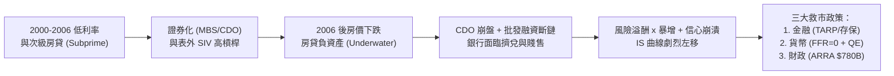

# 延伸型 IS-LM 模型、實質利率、風險溢酬與金融危機 (Extended IS-LM, Risk Premia & 2008 Crisis)

基礎 `IS-LM` 模型（[[is-lm-model-and-policy-mix|Ch.5]]）假設經濟體只有一種利率（央行設定的名目公債利率 $i$），且金融體系毫無摩擦。然而在現實世界與金融危機中，**企業與家庭借貸所面臨的利率，遠高於央行控制的短期無風險利率**。第 6 章（[[source-blanchard-chap-6|Blanchard Ch.6]]）透過三大延伸完成模型的現代化升級：
1. 區分**名目利率（$i_t$）**與**實質利率（$r_t$）**；
2. 納入違約風險與**風險溢酬（Risk Premium, $x$）**；
3. 納入**金融中介機構（銀行槓桿、資產流動性與擠兌風險）**。

---

## 1. 名目利率 vs. 實質利率與費雪方程式 (Fisher Equation)

### 1.1 定義與精確推導（Slides 4–10）
- **名目利率（Nominal Interest Rate, $i_t$）**：借入 1 美元，明年須償還 $(1 + i_t)$ 美元（以貨幣計價）。
- **實質利率（Real Interest Rate, $r_t$）**：放棄今日消費 1 單位商品，明年預期可換回 $(1 + r_t)$ 單位商品（以實質購買力計價）。
- 設當期物價為 $P_t$，明年預期物價為 $P_{t+1}^e$，預期通膨率為 $\pi_{t+1}^e = \frac{P_{t+1}^e - P_t}{P_t}$，則：
  $$1 + r_t = (1 + i_t)\frac{P_t}{P_{t+1}^e} = \frac{1 + i_t}{1 + \pi_{t+1}^e}$$
- **費雪方程式（Fisher Equation 線性近似）**：當 $r_t$ 與 $\pi_{t+1}^e$ 不大時，忽略乘積項 $r_t \cdot \pi_{t+1}^e \approx 0$，得：
  $$\mathbf{r_t \approx i_t - \pi_{t+1}^e} \quad \iff \quad i_t \approx r_t + \pi_{t+1}^e$$

### 1.2 事前（Ex-ante）vs. 事後（Ex-post）實質利率與 ZLB 限制
- **事前實質利率（Ex-ante real rate）**：$r_t = i_t - \pi_{t+1}^e$（基於「預期通膨」，是真正影響當期企業投資 $I$ 與進入 `IS` 曲線的變數）。
- **事後實質利率（Ex-post real rate）**：$r_t^{\text{realized}} = i_t - \pi_{t+1}$（基於事後「實際發生的通膨率」）。
- **零利率底限（ZLB）下的實質利率底限**：由於名目利率 $i_t \ge 0$，實質利率最低只能降到 **$r_t \ge -\pi_{t+1}^e$**。若經濟陷入預期通縮（$\pi_{t+1}^e < 0$），即使名目利率降至 `0%`，實質利率仍為正值（$r_t > 0$），將嚴重抑制投資！

---

## 2. 風險溢酬 (Risk Premium) 與金融中介脆弱性

### 2.1 風險溢酬公式（Slides 12–14）
設無風險政府公債名目利率為 $i$，風險企業債券利率為 $i + x$，違約機率（倒帳風險）為 $p$（違約時收回 0）。在風險中立（Risk-neutral）假設下，兩者預期報酬相等：
$$(1 + i) = (1 - p)(1 + i + x) + p(0) \implies \mathbf{x = \frac{(1 + i)p}{1 - p} > 0}$$
- 實務上，風險溢酬 $x$ 取決於：(1) **違約機率 $p$（信用風險）**；(2) **投資人的風險趨避程度（Risk aversion）**（不確定性升高時，即使 $p$ 微幅上升也會引發 $x$ 暴增，如 2008 年 9 月 `BBB` 企業債利差飆升）。

### 2.2 銀行資產負債表、槓桿率與擠兌機制（Slides 15–18）
- **資本比率（Capital Ratio）**$= \frac{\text{自有資本 (Capital)}}{\text{總資產 (Assets)}}$（例如 $\frac{20}{100} = 20\%$）。
- **槓桿比率（Leverage Ratio）**$= \frac{\text{總資產 (Assets)}}{\text{自有資本 (Capital)}} = \frac{1}{\text{Capital Ratio}}$（例如 $\frac{100}{20} = 5$ 倍）。
- **高槓桿的雙面刃與擠兌（Bank Runs）**：
  - 高槓桿能放大股東預期報酬率，但只要資產價值減損超過自有資本比例（如 5 倍槓桿下資產跌超過 20%），銀行即陷入**資不抵債（Insolvency）**。
  - 當銀行持有**低流動性資產（Illiquid assets，如房貸與企業放款）**卻依賴**高流動性負債（Liquid liabilities，如活存與短期批發融資 `Wholesale funding`）**時，一旦市場懷疑其資產品質並爭相提款，銀行被迫以**賤售價格（Fire sale prices）**拋售資產，造成帳面虧損擴大並引爆全面擠兌。

---

## 3. 延伸型 IS-LM 模型與中性利率 ($r^*$)

### 3.1 模型核心方程式（Slides 19–20）
$$\begin{cases} \text{IS Relation:} & Y = C(Y - T) + I(Y, \ \mathbf{r + x}) + G \\ \text{LM Relation:} & r = \bar{r} \end{cases}$$
- **政策利率（Policy Rate, $r = i - \pi^e$）**：由央行控制（縱軸變數）。
- **借款利率（Borrowing Rate, $r + x$）**：民間企業與消費者實際面臨的融資成本（決定投資 $I$）。

### 3.2 中性利率（Neutral Rate of Interest, $r^*$，Slides 21–23 補充）
- **定義**：使短期實際產出等於潛在產出（$Y = Y_f$）且通膨率穩定在目標值（如 Fed 的 `2%` 目標）時的短期實質利率 $r^*$。
- **判斷央行貨幣政策立場（Monetary Policy Stance）**：
  $$\text{名目政策利率 (FFR)} = r^* + \pi^e + \text{政策立場偏離值}$$
  1. **緊縮/限制性立場（Restrictive）**：實際實質利率 $r > r^*$（或 $\text{FFR} > r^* + \pi^e$）。
  2. **寬鬆立場（Accommodative）**：實際實質利率 $r < r^*$（或 $\text{FFR} < r^* + \pi^e$）。
  3. **中立立場（Neutral）**：$r = r^*$。

---

## 4. 2008 年次貸金融危機的傳導鏈與救市政策 (Subprime Crisis Case Study)

根據 Slides 24–39，2008 年全球金融海嘯在延伸型 `IS-LM` 中的完整演進如下：

- **為什麼傳統降息不夠用？** 當金融危機導致風險溢酬 $x$ 暴增時，即使 Fed 於 2008 年 12 月將名目政策利率降至 `0%`（受限於 `ZLB`，實質政策利率 $r$ 無法再降），民間借款利率 $r + x$ 依然極高。因此 Fed 必須啟動**非傳統貨幣政策（量化寬鬆 `QE`）**，直接買入長期公債與 `MBS` 以壓低風險溢酬 $x$（使 `IS` 右移）。

---

## 5. 關聯頁面與來源索引 (References)
- **相關概念**：[[is-lm-model-and-policy-mix|IS-LM 模型與財政貨幣政策搭配]]、[[money-market-and-monetary-policy|貨幣市場、利率決定與央行政策工具]]、[[inflation-and-price-indexes|通貨膨脹與物價指數]]
- **延伸對比**：[[fiscal-vs-monetary-policy-in-is-lm|短期總體政策對比：財政政策 vs. 貨幣政策與政策組合實證]]
- **引用來源**：[[source-blanchard-chap-6|Blanchard Macroeconomics Ch.6 - Financial Markets II: The Extended IS-LM Model]]
